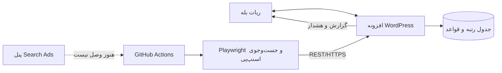

# پایش جایگاه اسنپ‌پی سارمو

این مخزن سامانهٔ پایش کلمات کلیدی و رتبهٔ محصولات سارمو استایل در جست‌وجوی اسنپ‌پی است. GitHub Actions اجرای مرورگر Playwright را هر ۱۰ دقیقه انجام می‌دهد؛ افزونهٔ WordPress وضعیت، نتایج و قواعد را نگه می‌دارد و گزارش‌ها/هشدارها را از بله می‌فرستد.

## وضعیت نسخهٔ ۰٫۶٫۰

- ورود پیامکی فقط پس از `/login` در بله یک بار مسلح می‌شود؛ collector مجوز را پیش از کلیک ارسال پیامک مصرف می‌کند. اجرای زمان‌بندی‌شدهٔ بی‌اجازه OTP نمی‌فرستد.
- collector فقط با API نسخهٔ `0.6.0` کار می‌کند؛ با افزونهٔ قدیمی‌تر قبل از خواندن کلمات/ارسال مشاهده متوقف می‌شود.
- رتبهٔ گرید، رتبه بین آگهی‌ها و جایگاه مطلق آگهی جدا ذخیره می‌شوند. قیمت، تخفیف، امتیاز/نمره و موجودیِ قابل مشاهدهٔ کارت‌ها هم برای گزارش رقبا ذخیره می‌شود؛ از روی آن‌ها الگوریتم پنهان اسنپ‌پی حدس زده نمی‌شود. هشدار کمپین براساس جایگاه مطلق آگهی و دو مشاهدهٔ معتبر پیاپی است.
- خطای منبع وضعیت جدا دارد؛ اسکن نامعتبر، ناقص یا تکراری افت رتبه محسوب نمی‌شود.
- حداکثر ۱۰ کلیدواژه برای کنترل مصرف runner؛ اسکن‌ها ترتیبی اجرا می‌شوند.
- اتصال Search Ads، bid، هزینه، کلیک و impression هنوز انجام نشده است. `/recommend` عمداً پیشنهاد قیمت نمی‌سازد و هیچ bid/budget تغییر نمی‌کند.

## معماری

## نصب افزونه

1. فایل `sarmo-snappay-monitor-0.6.0.zip` را از بستهٔ تحویل نهایی بردار و در WordPress بخش افزونه‌ها نصب/به‌روزرسانی کن. سورس PHP برای بازبینی در `wordpress-plugin/` است.
2. پس از بارگذاری، صفحهٔ ابزارهای وردپرس را باز کن و فعال‌بودن نسخهٔ ۰٫۶٫۰ و ستون جایگاه مطلق را بررسی کن.
3. افزونه نقش محدود `Sarmo Rank Collector` را می‌سازد. یک کاربر اختصاصی WordPress با این نقش ایجاد کن و برای آن Application Password بساز.
4. فقط در GitHub → Settings → Secrets and variables → Actions، سه Secret را قرار بده: `SARMO_WP_URL`, `SARMO_WP_USER`, `SARMO_WP_APP_PASSWORD`. رمز اصلی مدیر را استفاده نکن.
5. تنظیم token و chat ID بله را در Tools → اتصال بله سارمو نگه دار و وب‌هوک بله را به وردپرس ثبت کن. این پروژه با دادهٔ نمونه رتبه اعلام نمی‌کند.

## راه‌اندازی و آزمون

- محلی: Node.js 22+ و Playwright `1.65.0`؛ در ریشهٔ مخزن اجرا کنید: `npm install`, `npx playwright install chromium`, `node --test *.test.mjs`.
- GitHub Actions: workflow قبل از crawl آزمون‌های Node و lint سه فایل PHP را اجرا می‌کند. بعد از انتشار، اولین run باید در گام API contract نسخهٔ WordPress را برابر `0.6.0` بیابد.
- برای OTP: در گفت‌وگوی خصوصی و مالک ربات `/login 09xxxxxxxxx` را بفرست؛ تلاش تا ۳۰ دقیقه معتبر است. collector بعد از claim پیام بله می‌فرستد و یک SMS درخواست می‌کند. همان کد تازه را فقط در همان گفت‌وگو بفرست. خطا/انقضا نیازمند `/login` تازه است؛ cooldown درخواست مجدد ۱۰ دقیقه است.
- اگر API contract برابر نباشد، نشست نامعتبر باشد یا اسکن کامل نشود، داده به‌عنوان رتبهٔ افت‌کرده گزارش نمی‌شود.

## فرمان‌های بله

`/add کلیدواژه`, `/remove کلیدواژه`, `/list`, `/report [کلیدواژه]`, `/campaign کلیدواژه جایگاه`, `/campaign_off کلیدواژه`, `/campaign_report [کلیدواژه]`, `/competitors کلیدواژه`, `/catalog`, `/recommend`, `/status`, `/login_status`.

`/campaign روسری 1` یعنی هشدار وقتی جایگاه مطلق آگهی از هدف ۱ خارج شود. `/campaign_report` فقط جایگاه را نشان می‌دهد؛ چون دادهٔ Search Ads هنوز وصل نیست، هزینه/bid ندارد.

## متغیرهای اختیاری GitHub Actions

این موارد را در Actions Variables، نه Secrets، تنظیم کن؛ مقدارها با کاما جدا شوند:

- `SARMO_MERCHANT_ALIASES` (پیش‌فرض: `سارمو استایل`؛ فقط نام فروشندهٔ تأییدشده)
- `SARMO_PRODUCT_IDS` (شناسه‌های محصولی که از کارت‌های واقعی تأیید شده‌اند)
- `SARMO_SELLER_IDS` (شناسهٔ فروشندهٔ رسمی اسنپ‌پی)

تا وقتی شناسهٔ پایدار استخراج و دستی تأیید نشده، مالکیت بر مبنای نام فروشندهٔ دقیق باقی می‌ماند. محصول Shopino یا رقیب به سارمو نسبت داده نمی‌شود.

## محدودیت‌های اجرایی

- GitHub cron ممکن است در ساعات پرترافیک دیر اجرا شود. وضعیت workflow دوره‌ای بررسی شود.
- گزارش ۰۹:۰۰ وردپرس به WP-Cron وابسته است؛ برای زمان دقیق، cron واقعی هاست `wp-cron.php` را اجرا کند.
- هویت HTML اسنپ‌پی می‌تواند تغییر کند؛ خطای selector باید وضعیت منبع نامعتبر بسازد.
- پنل Search Ads به collector متصل نیست؛ برای پیاده‌سازی آن، دسترسی مرورگر پنل و یک برداشت واقعی از DOM/گزارش کمپین لازم است. هیچ داده‌ای حدس زده نشود.
