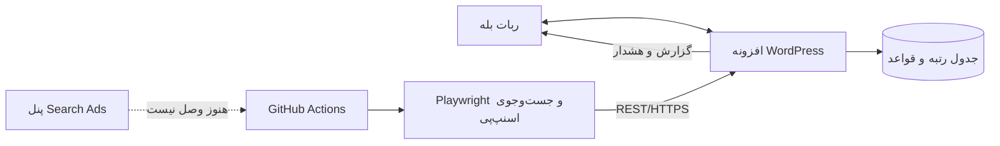

# پایش جایگاه اسنپ‌پی سارمو

این مخزن سامانهٔ پایش کلمات کلیدی و رتبهٔ محصولات سارمو استایل در جست‌وجوی اسنپ‌پی است. پس از استقرار نسخهٔ هماهنگ وردپرس و فعال‌کردن متغیر کنترل مصرف، GitHub Actions اجرای مرورگر Playwright را هر ۱۰ دقیقه انجام می‌دهد؛ افزونهٔ WordPress وضعیت، نتایج و قواعد را نگه می‌دارد و گزارش‌ها/هشدارها را از بله می‌فرستد.

## نسخهٔ کاندید ۰٫۷٫۰ — آمادهٔ آزمون؛ هنوز روی وردپرس زنده نصب نشده

- ورود پیامکی فقط پس از `/login` در بله یک بار مجاز می‌شود؛ collector مجوز را پیش از کلیک ارسال پیامک مصرف می‌کند. اجرای زمان‌بندی‌شدهٔ بی‌اجازه OTP نمی‌فرستد.
- پاسخ HTTP 429 یا پیام محدودیت اسنپ‌پی، قفل ۱۲ساعته ایجاد می‌کند. در زمان قفل، `/login` و OTP رد می‌شوند، نشست قبلی حفظ می‌شود و `/login_status` زمان مجازشدن را نشان می‌دهد. خطای محدودیت با علت به بله می‌رود.
- collector فقط با API نسخهٔ `0.7.0` و حالت OTP آگاه از rate limit کار می‌کند؛ با افزونهٔ قدیمی‌تر قبل از خواندن کلمات/ارسال مشاهده متوقف می‌شود.
- رتبهٔ گرید، رتبه بین آگهی‌ها و جایگاه مطلق آگهی جدا ذخیره می‌شوند. قیمت، تخفیف، امتیاز/نمره و موجودیِ قابل مشاهدهٔ کارت‌ها هم برای گزارش رقبا ذخیره می‌شود؛ از روی آن‌ها الگوریتم پنهان اسنپ‌پی حدس زده نمی‌شود. هشدار کمپین براساس جایگاه مطلق آگهی و دو مشاهدهٔ معتبر پیاپی است.
- خطای منبع وضعیت جدا دارد؛ اسکن نامعتبر، ناقص یا تکراری افت رتبه محسوب نمی‌شود.
- حداکثر ۱۰ کلیدواژه برای کنترل مصرف runner؛ اسکن‌ها ترتیبی اجرا می‌شوند.
- اجرای ۱۰دقیقه‌ای با preflight شروع می‌شود؛ اگر API افزونه هنوز ۰٫۷٫۰ نباشد یا قفل ۴۲۹ فعال باشد، browser نصب/اجرا نمی‌شود و هیچ SMS تازه‌ای درخواست نمی‌شود. متغیر `SARMO_COLLECTOR_ENABLED` همچنان کلید روشن/خاموش کلی است.
- اتصال Search Ads، bid، هزینه، کلیک و impression هنوز انجام نشده است. `/recommend` عمداً پیشنهاد قیمت نمی‌سازد و هیچ bid/budget تغییر نمی‌کند.

## گزارش کارت‌های بازار — نسخهٔ ۰٫۷٫۰

- فرمان `/competitors کلیدواژه` در نسخهٔ کاندید، محصولات سارمو را کنار رقبا می‌آورد: جایگاه کارت، نشان آگهی، قیمت خود کالا، امتیاز قابل‌نمایش، تعداد نظر، تخفیف و موجودی؛ فقط فیلدهایی که واقعاً روی کارت آمده‌اند گزارش می‌شوند.
- گزارش زمان مشاهده را به وقت تهران نشان می‌دهد و اگر اسکن ناقص باشد، نبودن محصول سارمو را نتیجهٔ قطعی اعلام نمی‌کند.
- صریحاً توضیح می‌دهد که قیمت کارت، قیمت محصول است و هزینهٔ تبلیغ یا کلیک در صفحهٔ فروشگاهی اسنپ‌پی قابل‌دیدن نیست. برای هزینه باید منبع پنل Search Ads جداگانه وصل شود.
- افزونهٔ زندهٔ وردپرس هنوز ۰٫۶٫۰ است. ZIP نسخهٔ ۰٫۷٫۰ کاندید است و قبل از استقرار باید workflow آزمون PHP/Node را پاس کند.

## معماری

## نصب افزونه

1. برای سایت زندهٔ فعلی، افزونهٔ فعال ۰٫۶٫۰ است. نسخهٔ کاندید `sarmo-snappay-monitor-0.7.0.zip` را فقط پس از پاس شدن CI و تأیید استقرار جایگزین کن. سورس PHP برای بازبینی در `wordpress-plugin/` است.
2. پس از به‌روزرسانی، صفحهٔ ابزارهای وردپرس را باز کن و نسخهٔ ۰٫۷٫۰ و قرارداد collector را بررسی کن.
3. افزونه نقش محدود `Sarmo Rank Collector` را می‌سازد. یک کاربر اختصاصی WordPress با این نقش ایجاد کن و برای آن Application Password بساز.
4. فقط در GitHub → Settings → Secrets and variables → Actions، سه Secret را قرار بده: `SARMO_WP_URL`, `SARMO_WP_USER`, `SARMO_WP_APP_PASSWORD`. رمز اصلی مدیر را استفاده نکن.
5. تنظیم token و chat ID بله را در Tools → اتصال بله سارمو نگه دار و وب‌هوک بله را به وردپرس ثبت کن. این پروژه با دادهٔ نمونه رتبه اعلام نمی‌کند.

## راه‌اندازی و آزمون

- محلی: Node.js 22+ و Playwright `1.65.0`؛ در ریشهٔ مخزن اجرا کنید: `npm install`, `npx playwright install chromium`, `node --test *.test.mjs`.
- GitHub Actions: workflow «Sarmo SnappPay checks» lint PHP، سه آزمون PHP، آزمون‌های Node و بررسی نحوی MJS را اجرا می‌کند. schedule collector با `SARMO_COLLECTOR_ENABLED=true` فعال است؛ preflight در صورت API قدیمی یا قفل ۴۲۹، نصب Chromium و crawl را رد می‌کند.
- برای OTP: `/login 09xxxxxxxxx` را در گفت‌وگوی خصوصی ربات بله بفرست. اگر سرویس پیامک را با 429 محدود کرده باشد، ربات زمان مجازشدن را در `/login_status` نشان می‌دهد و تلاش تازه تا آن زمان بسته می‌ماند. اگر پیامک رسید، فقط همان کد تازه را در همان گفت‌وگو بفرست.
- اگر API contract برابر نباشد، نشست نامعتبر باشد یا اسکن کامل نشود، داده به‌عنوان رتبهٔ افت‌کرده گزارش نمی‌شود.

## فرمان‌های بله

`/add کلیدواژه`, `/remove کلیدواژه`, `/list`, `/report [کلیدواژه]`, `/campaign کلیدواژه جایگاه`, `/campaign_off کلیدواژه`, `/campaign_report [کلیدواژه]`, `/competitors کلیدواژه`, `/catalog`, `/recommend`, `/status`, `/login_status`.

`/campaign روسری 1` یعنی هشدار وقتی جایگاه مطلق آگهی از هدف ۱ خارج شود. `/campaign_report` فقط جایگاه را نشان می‌دهد؛ چون دادهٔ Search Ads هنوز وصل نیست، هزینه/bid ندارد.

## متغیرهای اختیاری GitHub Actions

این موارد را در Actions Variables، نه Secrets، تنظیم کن؛ مقدارها با کاما جدا شوند:

- `SARMO_MERCHANT_ALIASES` (پیش‌فرض: `سارمو استایل`؛ فقط نام فروشندهٔ تأییدشده)
- `SARMO_PRODUCT_IDS` (شناسه‌های محصولی که از کارت‌های واقعی تأیید شده‌اند)
- `SARMO_SELLER_IDS` (شناسهٔ فروشندهٔ رسمی اسنپ‌پی)

تا وقتی شناسهٔ پایدار استخراج و دستی تأیید نشده، مالکیت بر مبنای نام فروشندهٔ دقیق باقی می‌ماند. محصول Shopino یا رقیب به سارمو نسبت داده نمی‌شود.

## محدودیت‌های اجرایی

- GitHub cron ممکن است در ساعات پرترافیک دیر اجرا شود. وضعیت workflow دوره‌ای بررسی شود.
- گزارش ۰۹:۰۰ وردپرس به WP-Cron وابسته است؛ برای زمان دقیق، cron واقعی هاست `wp-cron.php` را اجرا کند.
- هویت HTML اسنپ‌پی می‌تواند تغییر کند؛ خطای selector باید وضعیت منبع نامعتبر بسازد.
- پنل Search Ads به collector متصل نیست؛ برای پیاده‌سازی آن، دسترسی مرورگر پنل و یک برداشت واقعی از DOM/گزارش کمپین لازم است. هیچ داده‌ای حدس زده نشود.
